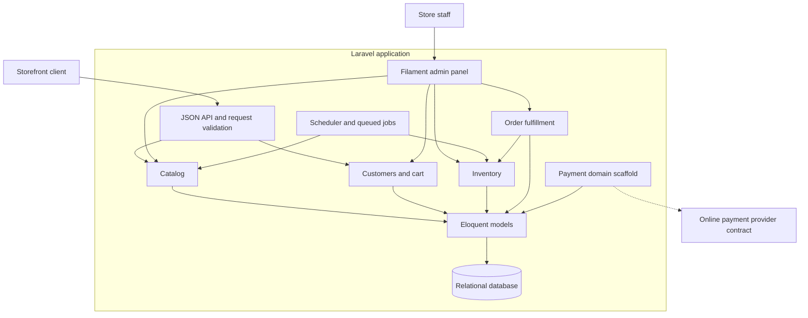
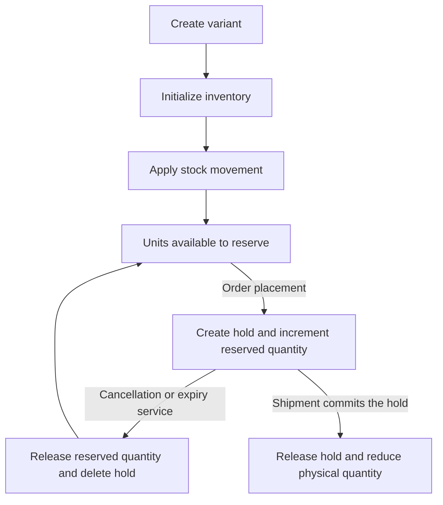
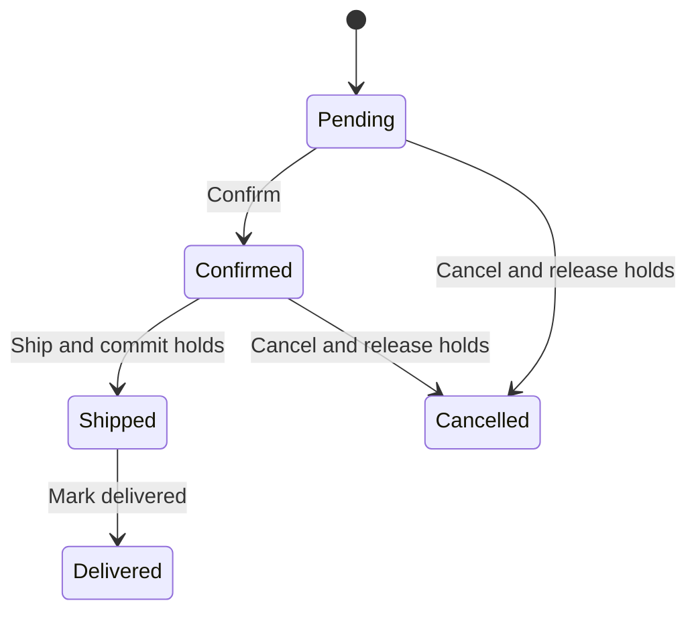
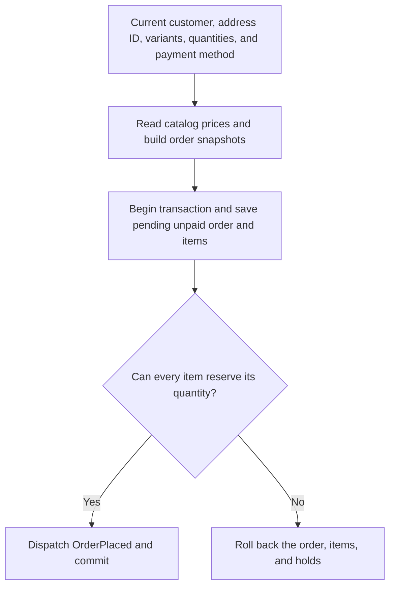
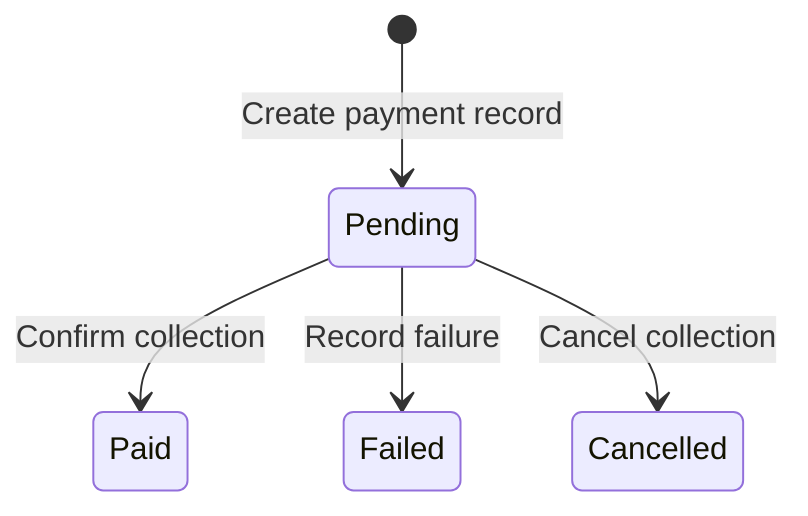

# 7AKE | حَكِي

**A Laravel commerce backend for Arabic apparel, with bilingual catalog management, variant-level stock reservations, and order fulfillment.**


**Status · Active development.** Catalog administration, stock adjustments, and core inventory and order operations are implemented. The customer purchase flow is still being integrated.

[Architecture](#system-architecture) · [Engineering highlights](#engineering-highlights) · [Workflows](#business-workflows) · [API](#api-design) · [Setup](#getting-started)

## Project overview

7AKE is an Arabic clothing brand centered on text-led designs for hoodies and T-shirts. The backend supports Arabic and English catalog content and gives staff one place to manage merchandise, monitor stock, and work through orders. The customer API is intended to serve separate storefront clients.

A clothing design can have several size and color variants, each with its own price and stock. The backend therefore tracks availability per variant, holds units when an order is placed, and stores the price and delivery address used at order time. The catalog, inventory, and order rules live in one Laravel application so a single database transaction can cover changes across those modules.

## Key features

- **Catalog.** Manage products, categories, colors, collections, and images in Filament. Catalog names and descriptions support Arabic and English. Variants have size, color, price, and a SKU generation action. Collections support immediate and scheduled publication.
- **Inventory.** Track physical, reserved, and available quantities per variant. Create temporary stock holds for order items and record stock adjustments with reasons.
- **Customers and cart.** Store customer profiles and delivery addresses, inspect addresses in Filament, and associate a guest cart with a customer at the service layer. Customer authentication and cart endpoints still need integration work.
- **Orders.** Create orders and stock holds together at the service layer. Filament provides order search, filters, details, and fulfillment actions. Customer checkout and parts of the shipping and cancellation workflows remain in development.
- **Payments.** Payment records and cash-on-delivery and remittance handlers are modeled in code. Persisted collection, online providers, and financial settlement are pending.

## Technology stack

| Area | Technology | Usage |
| --- | --- | --- |
| Runtime and backend | PHP 8.5 in CI, Laravel 13.32 | HTTP routing, Eloquent, transactions, events, queues, and scheduling |
| Administration | Filament 5.10 | Staff panel, resources, form actions, and order overview widgets |
| Customer authentication | Laravel Sanctum 4.3 | Personal access token infrastructure and the `auth:sanctum` guard |
| Catalog translations | Spatie Laravel Translatable 6.15 and Filament Translatable Tabs 5 | Arabic and English fields and editing tabs |
| Web shell and build | Inertia 3, Vue 3.5, TypeScript, Tailwind CSS 4, Vite 8, and Vite+ 0.3 | Welcome page and asset tooling, with Laravel Wayfinder 0.1 configured for route generation |
| Local persistence | SQLite | Default development database, in-memory test database, and database-backed development sessions, cache, and queue |
| Testing and CI | Pest 5.2, Laravel Pint, Larastan 3, and GitHub Actions | Feature tests, formatting, static analysis, and CI checks |

Versions are based on the repository lockfiles and CI configuration. [PHP dependencies](composer.lock) · [JavaScript dependencies](package-lock.json) · [CI workflow](.github/workflows/tests.yml)

## System architecture

7AKE is an **API-first modular monolith**. One Laravel application serves the customer API and Filament panel. Its business modules are grouped by responsibility within the application, mainly in `app/Models`, `app/Core`, and `app/Services`.



- **HTTP and administration.** Controllers handle JSON requests and validation. Filament resources configure staff forms, tables, and actions. Order actions call `OrderFulfillmentDomain`, and the stock adjustment action delegates to `InventoryDomain`.
- **Application services and domain models.** `CustomerService` and `CartService` handle account data and cart operations. Domain classes under `app/Core` coordinate tasks such as order placement and reservation updates, while Eloquent models define relations, enum casts, and individual state changes.
- **Persistence and integrations.** Migrations define relational constraints. Events connect variant creation to inventory initialization. The scheduler dispatches collection publication and reservation cleanup jobs. Laravel filesystem disks handle uploads, and `OnlinePaymentProvider` defines the extension point for a future provider adapter.

The shared database makes order placement and stock reservation one unit of work. Keeping that operation behind a domain service gives the admin panel, customer API, and background jobs a common place to use or extend business rules as their integration grows.

## Module breakdown

| Module | Responsibility | Implementation status |
| --- | --- | --- |
| [Catalog](app/Models/Catalog) | Product descriptions, size and color variants, media, categories, and merchandising collections | **Implemented in Filament.** API lists are wired. Slug lookups and publication filtering need further work. |
| [Inventory](app/Core/Inventory) | Stock counters, reservations, stock movements, and expiry processing | **Core implemented.** Scheduled expiry selection and the shipment-to-movement link need correction. |
| [Customers](app/Models/Customer) | Customer profiles, contact details, and delivery addresses | **Partial.** Profile and address models and staff lookup exist. Customer registration, token issuance, and self-service address endpoints remain incomplete. |
| [Cart](app/Services/CartService.php) | Cart lookup, guest association, and variant line items | **Partial.** The service and routes exist. Session and authentication wiring and quantity updates need work. |
| [Orders](app/Core/Order) | Order creation, snapshot data, totals, and fulfillment transitions | **Partial.** Domain operations and Filament management exist. Customer checkout and fulfillment edge cases remain open. |
| [Payments](app/Core/Payment) | Payment record lifecycle, offline collection methods, and provider contract | **Scaffolded.** The payment schema, order payment synchronization, and provider integrations are pending. |

## Engineering highlights

**Stock availability is checked at the write.** An inventory item stores physical `quantity` and `reserved_quantity`, so availability is `quantity - reserved_quantity` without summing holds on each read. When reserving units, the database increments the reserved count only if the row still has enough available stock. The counter update and reservation insert share a transaction. Stock decrements use a similar conditional write to preserve units already held. [Inventory domain](app/Core/Inventory/InventoryDomain.php)

**Order history survives catalog and address changes.** Order placement reads the variant price server-side, stores the product name, unit price, quantity, and line total on each order item, and copies the shipping address onto the order. Order rows, line items, and stock holds are written in one transaction. If any line cannot reserve enough stock, placement rolls back. [Order creation service](app/Core/Order/OrderDomain.php) · [Order model](app/Models/Order/Order.php)

**Fulfillment transitions have explicit preconditions.** Confirmation and delivery reload the current order inside a transaction using `lockForUpdate()`, then check whether its persisted status permits the requested transition. This protects those transitions from stale model instances on databases that support row-level locking. Confirmation leaves the reservation in place. Cancellation and shipping use separate paths whose reservation handling still needs hardening. [Fulfillment service](app/Core/Order/OrderFulfillmentDomain.php)

**Stock movements explain physical changes.** A manual adjustment changes the on-hand quantity and creates a movement with a quantity and reason in the same transaction. Reservation release changes the reserved counter only. Shipping also writes sale movements, but currently passes a variant ID where the movement needs an inventory item ID. [Stock movement schema](database/migrations/2026_09_22_104358_create_stock_movements_table.php) · [Inventory domain](app/Core/Inventory/InventoryDomain.php)

**Database constraints preserve key relationships.** Unique constraints cover order numbers, guest tokens, customer carts, and each cart/variant pair. Foreign keys restrict deletion of variants used in order items. `CartService` prefers a customer’s existing cart and can claim the token-matched cart when the customer has none. Merging items from two carts remains open. [Migrations](database/migrations) · [Cart service](app/Services/CartService.php)

**Payment collection and order payment state are modeled separately.** A payment has its own status and an order has a paid/unpaid flag, allowing the design to represent several payment attempts for an order. The payment service includes repeat-state guards for paid, cancelled, and failed transitions. Those guards are present in code, while persistence and end-to-end retry guarantees depend on completing the schema and integration. Financial settlement and reconciliation are roadmap items. [Payment domain](app/Core/Payment/PaymentDomain.php) · [Provider contract](app/Core/Payment/PaymentGateway/OnlinePaymentProvider.php)

## Business workflows

### Inventory lifecycle

Variant creation triggers an observer and listener that initialize a zero-stock inventory row. Staff can enter stock through the movement action. An order-item reservation places a one-hour hold. Cancellation and expiry release reserved units and remove the reservation row. Committing the reservation at shipment also reduces physical stock.



The expiry job is scheduled every ten minutes. Its query currently looks for a text `active` status, while the reservation model writes an integer-backed status. The expiry service is implemented and tested directly. Scheduled cleanup and shipment behavior after expiry still need integration work. [Expiry job](app/Core/Inventory/EvaluateExpiredReservationJob.php) · [Reservation status](app/Enums/ReservationStatus.php)

### Order lifecycle

The fulfillment service defines these transitions. Filament exposes the corresponding record actions by status. Shipment commits the order’s remaining holds and attempts to write sale movements in the same transaction. `RETURNED` exists as an enum value and awaits a return workflow.



### Checkout

**Implemented at the service layer. Customer checkout is planned.** `OrderDomain::createOrder()` accepts order items and a customer address, reads the current customer and variant prices, and calculates totals. Shipping and discount calculators currently return zero. The API checkout route is commented out, so storefront checkout still needs a request handler, customer address validation, cart integration, and payment initiation.



### Payment lifecycle

**Modeled in code. Persisted collection is pending.** The cash-on-delivery and remittance handlers call the core service to create a pending payment and attempt to update order payment state after collection. The `payments` migration currently creates only the ID and timestamps, and the order payment update lacks persistence. The online provider contract covers initiation, status lookup, and webhook event parsing. A provider adapter, webhook endpoint, remittance evidence upload, and settlement workflow are pending.



## API design

The JSON API uses the `/api` prefix and is currently unversioned. Catalog reads are public. The product list returns Laravel’s paginator JSON with 10 records per page. Other catalog handlers return model or collection JSON directly. API exceptions render as JSON. Login returns a JSON `401` for invalid credentials and is designed to return a user, an `access_token`, and a `Bearer` token type on success.

| Method | Endpoint | Current behavior |
| --- | --- | --- |
| `GET` | `/api/catalog/products` | Paginated products with associated collections. The query has no publication-status filter. |
| `GET` | `/api/catalog/categories` | Lists categories. |
| `GET` | `/api/catalog/collections` | Lists collections associated with products. |
| `GET` | `/api/catalog/upcoming-collections` | Lists collections whose `published_at` value is in the future. |
| `GET` | `/api/catalog/products/{slug}`, `/api/catalog/collections/{slug}` | Registered detail routes. The product and collection tables still need slug columns. |
| `POST` | `/api/customer-auth/register`, `/api/customer-auth/login` | Registered customer auth routes. Registration fields and Sanctum token issuance need fixes. |
| `GET` | `/api/user` | Returns the authenticated user through `auth:sanctum`. |
| `GET`, `POST`, `DELETE` | `/api/cart`, `/api/cart/items`, `/api/cart/items/{id}` | Registered cart routes. The effective route stack lacks the intended customer authentication and session middleware. Adding an existing variant currently leaves its quantity unchanged. |

The customer address, checkout, order history, and payment APIs are pending. [Route definitions](routes/api.php) · [Controllers](app/Http/Controllers) · [API bootstrap](bootstrap/app.php)

## Administration panel

Filament serves the admin panel at `/admin` with session-based login. The panel groups resources around the work staff do day to day.

| Area | Available screens and actions |
| --- | --- |
| Catalog | Edit Arabic and English content, manage categories and colors, add size and color variants and media, and publish or archive products and collections. |
| Inventory | View physical, reserved, and available stock, filter low-stock or reserved items, and enter and review stock movements. |
| Customers | Browse customer records and inspect saved addresses in a modal. |
| Orders | View status counts and order details, search by order number or customer contact, filter by status and date, and access fulfillment actions. The list shows payment status as unavailable. |

[Panel registration](app/Providers/Filament/AdminPanelProvider.php) · [Filament resources](app/Filament/Resources)

### Screenshots

*Placeholders for screenshots to be added manually.*

- **Bilingual product editor** · Arabic and English fields, variant details, and media.
- **Inventory overview and movement history** · Physical, reserved, and available stock alongside a sample adjustment.
- **Orders list and order detail** · Filters, status counts, fulfillment actions, line items, and totals using sample customer data.
- **Collection publishing** · The scheduling dialog and a collection with a future publish date.

## Repository structure

```text
app/
├── Core/            Order, inventory, payment, and catalog operations
├── Models/          Eloquent models, relationships, and domain enums
├── Services/        Customer and cart operations
├── Http/            API controllers, requests, and middleware
├── Filament/        Admin resources, forms, tables, and widgets
├── Providers/      Application and Filament configuration
└── Events/         Domain events, with handlers in app/Listeners/
database/
├── migrations/     Schema and relational constraints
├── factories/      Test data builders
└── seeders/        Optional development user
resources/          Inertia welcome page, styles, and admin Blade views
routes/             Web, API, and scheduler definitions
tests/Feature/      Inventory, orders, and Filament feature tests
```

## Getting started

### Prerequisites

- **PHP 8.5 and Composer 2**, matching CI. Enable PDO SQLite for the default database and check the remaining PHP extensions with `composer check-platform-reqs --lock`. The locked dev dependencies require PHP 8.4 or later.
- **Node.js 22.18 or later in the Node 22 line**, with npm. CI uses Node 22 and the locked Vite+ toolchain requires at least 22.18 on that line.

### Install and configure

From a fresh checkout, run the following from the repository root.

```bash
composer install
cp .env.example .env
php artisan key:generate
touch database/database.sqlite
php artisan migrate
npm install
php artisan storage:link
```

Keep `DB_CONNECTION=sqlite` in `.env` to use `database/database.sqlite`. If using a different database, configure the connection before running migrations. `storage:link` exposes the public disk used by the catalog image gallery. The optional `php artisan db:seed` creates a single development user. Demo catalog and order records require separate setup.

### Run the application

```bash
composer run dev
```

This starts the Laravel server, queue listener, and Vite development server. To run scheduled tasks locally, start the scheduler in a second terminal and leave the queue listener running.

```bash
php artisan schedule:work
```

### Sign in to Filament

Create a local panel user through the interactive prompt, then open [the local admin panel](http://localhost:8000/admin).

```bash
php artisan make:filament-user --panel=admin
```

Keep Vite running for the admin panel. The panel references `resources/css/filament/admin/theme.css`, which is missing from the configured Vite build inputs. `npm run build` builds the welcome-page assets. Serving Filament from the built manifest requires adding its theme as a build entry.

## Testing

Pest feature tests use Laravel’s `RefreshDatabase`, model factories, and in-memory SQLite. The suite exercises reservation creation and release, stock changes, order creation and insufficient-stock failures, fulfillment rules, and Filament order listing and actions. Some inventory tests imitate stale reads to check conditional updates.

```bash
npm run build
php artisan test --compact
php artisan test --compact tests/Feature/InventoryDomainTest.php
```

The first command generates the welcome-page assets used by the home-route test. `composer test` runs Pint, Larastan, and the PHP suite. GitHub Actions runs `composer setup` and `composer ci:check`, which also runs frontend checks and type checking. Known failures involve inventory fixtures missing a required variant color, insufficient-stock errors during order placement tests, legacy order status casting, Filament action expectations, and the missing admin theme manifest entry. [Feature tests](tests/Feature) · [CI workflow](.github/workflows/tests.yml)

## Roadmap

- **Finish the storefront API.** Complete customer authentication and addresses, cart session handling and quantity updates, catalog slug lookups, and publication filtering.
- **Expose customer checkout.** Connect validated customer and cart data to order placement, and define shipping, discount, and currency rules.
- **Complete fulfillment.** Enforce one inventory row per variant in the database, align the expiry job with persisted reservation statuses, reconcile holds at shipment, correct sale movement references, and implement returns and order notifications.
- **Complete payments.** Add the payment schema and persist order payment state. Finish offline collection and remittance evidence, then implement an online adapter, verified webhook handling, reconciliation, and settlement.
- **Build the admin theme for deployment.** Include the Filament stylesheet in the Vite build and bring order resource tests in line with the supported actions and status values.

## License

A repository-level license has yet to be selected. `composer.json` declares MIT in the Laravel starter metadata. Confirm the project’s license before public release.
